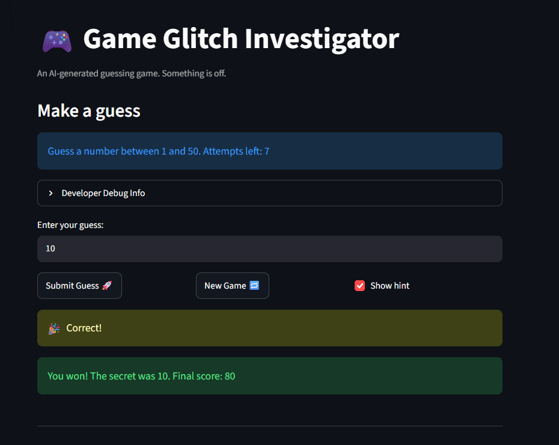

# 🎮 Game Glitch Investigator: The Impossible Guesser

## 🚨 The Situation

You asked an AI to build a simple "Number Guessing Game" using Streamlit.
It wrote the code, ran away, and now the game is unplayable.

- You can't win.
- The hints lie to you.
- The secret number seems to have commitment issues.

## 🛠️ Setup

1. Install dependencies: `pip install -r requirements.txt`
2. Run the broken app: `python -m streamlit run app.py`

## 🕵️‍♂️ Your Mission

1. **Play the game.** Open the "Developer Debug Info" tab in the app to see the secret number. Try to win.
2. **Find the State Bug.** Why does the secret number change every time you click "Submit"? Ask ChatGPT: _"How do I keep a variable from resetting in Streamlit when I click a button?"_
3. **Fix the Logic.** The hints ("Higher/Lower") are wrong. Fix them.
4. **Refactor & Test.** - Move the logic into `logic_utils.py`.
   - Run `pytest` in your terminal.
   - Keep fixing until all tests pass!

## 📝 Document Your Experience

- [x] Describe the game's purpose - Guess a number game!
- [x] Detail which bugs you found:
  - Attempts allowed displayed in settings is not the same as the one in the game. I expected 8, see both 7 and 8 but in reality there.
  - Developer Debug counter for attempts shows 1 attempt completed before even starting. It should say 0.
  - Asks to guess number between 1 and 100, I guessed 0 and it said to go lower, guessed 30 said go lower, answer was 25. It should say "go higher" and "go lower" dependsing on if the number submitted is greater or less than the secret number.
  - Clicking new game does not clean history or let me resubmit a guess. It should do that.
  - Normal level should say to guess number 1-50, shows 1-100, while hard says 1-50 instead of 1-100.
- [x] Explain what fixes you applied: Fixes to all of the above!

## 📸 Demo Walkthrough

Describe your fixed game in numbered steps so a reader can follow along without watching a video:

1. User enters the number 4, they must guess number between 1-50 in normal mode
2. Attempts left is reduced 1 number and game returns "Go LOWER!"
3. User enters the number 2
4. Attempts left is reduced 1 number and game returns "Go HIGHER!"
5. New Game is clicked
6. Attempts left restart, new number must be guessed
7. Number 10 is guessed
8. Balloons appear and the following message appears: "You won! The secret was 12. Final score: 80"

**Screenshot**: <!-- Insert a screenshot of your fixed, winning game here -->


## 🧪 Test Results

```
# Paste your pytest output here, e.g.:
# pytest tests/
# ========================= 5 passed in 2.45s =========================
```
